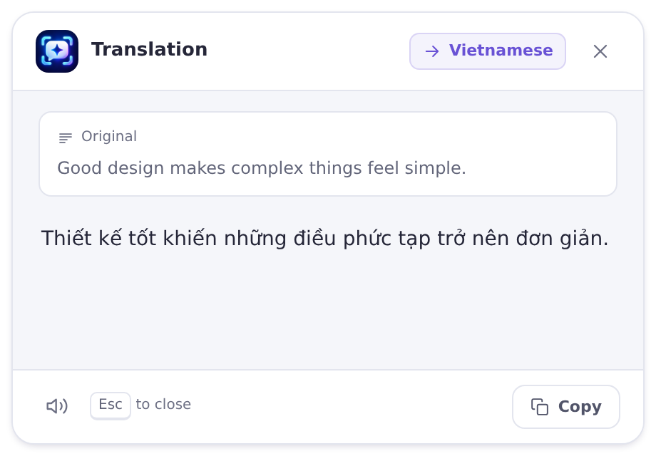
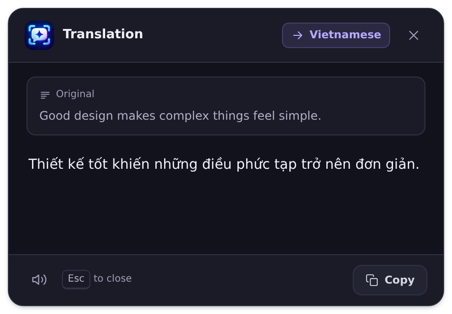

<p align="center">
  
</p>

<h1 align="center">ContextKey</h1>

<p align="center">
  <strong>Understanding, a shortcut away.</strong><br />
  Translate text, ask follow-up questions, and understand screenshots from your Windows desktop.
</p>

<p align="center">
  <a href="https://github.com/phungvanquy/ContextKey/releases"></a>
  <a href="https://github.com/phungvanquy/ContextKey/actions/workflows/build.yml"></a>
  
</p>

<p align="center">
  <a href="https://github.com/phungvanquy/ContextKey/releases"><strong>Download for Windows</strong></a> ·
  <a href="#getting-started">Getting started</a> ·
  <a href="#configuration">Configuration</a> ·
  <a href="docs/DEVELOPMENT.md">Development</a> ·
  <a href="https://github.com/phungvanquy/ContextKey/issues">Report an issue</a>
</p>

---

Select text or capture a screen region, invoke a shortcut, and work with the result in a popup beside your cursor. ContextKey runs in the system tray and connects to the API endpoint and models you choose.

| Light theme | Dark theme |
| :---: | :---: |
|  |  |

<p align="center">
  <sub>Browser previews with sample text. <a href="docs/previews/README.md">Explore the chat, settings, and appearance previews →</a></sub>
</p>

## Features

- **Translate in place.** Stream translations into a popup, then copy the result or listen with read-aloud controls.
- **Chat with context.** Ask follow-up questions about selected text or start a general conversation.
- **Ask about your screen.** Capture a region on any monitor, review it, and send a question to an image-capable model.
- **Use your preferred provider.** Configure an OpenAI-compatible endpoint, separate text and vision models, and your own translation instructions.
- **Make it your own.** Customize the shortcuts and choose a light, dark, or system theme.

**Platform:** Windows. Global shortcuts use Windows APIs; macOS and Linux desktop support is not implemented.

## Getting started

You need a Windows PC and an API key for a compatible Chat Completions endpoint. Screenshot questions also require an image-capable model.

1. **Install.** Download the Windows installer (`*-setup.exe`) from [Releases](https://github.com/phungvanquy/ContextKey/releases), then install and launch ContextKey.
2. **Connect.** Settings opens automatically when no API key is configured. Enter your **API key**, **Base URL**, and **Model**.
3. **Personalize.** Set your **Target language**. Add a **Vision model** if you want to use a different model for screenshots.
4. **Save.** Select **Test connection**, then **Save changes**. Reopen Settings from the system tray whenever you need it.
5. **Try it.** Select text in another application, hold <kbd>Ctrl</kbd>, and press <kbd>C</kbd> twice to translate.

The installer downloads WebView2 if needed, which requires an internet connection. The standalone `contextkey.exe` requires WebView2 to be installed already. In the current source, the standalone EXE and upcoming smaller Store package show a Windows prompt when WebView2 is unavailable, offering Microsoft's Evergreen download page; install the runtime and reopen ContextKey. The published v0.5.0 MSIX still bundles its runtime. See the [development guide](docs/DEVELOPMENT.md#local-development) for runtime and build details.

For earlier releases named **Quick Translator**, see [automatic settings migration](#upgrading-from-quick-translator).

## Keyboard shortcuts

| Action | Default sequence | How to use it |
| --- | --- | --- |
| Translate | <kbd>Ctrl</kbd> + <kbd>C</kbd> → <kbd>C</kbd> | Select text, hold Ctrl, and press C twice within 600 ms. Release C between presses. |
| Chat | <kbd>Ctrl</kbd> + <kbd>C</kbd> → <kbd>Space</kbd> | Select text, press Ctrl+C, then press Space within 600 ms while continuing to hold Ctrl. |
| Screenshot | <kbd>Right Ctrl</kbd> → <kbd>Right Ctrl</kbd> | Press and release Right Ctrl twice within 400 ms, then drag to select a screen region. |

These are two-step sequences. Customize them in **Settings → Shortcuts** and select **Save changes** to apply them immediately.

Shortcut keystrokes also reach the foreground application. Choose bindings that work well with your other tools; with a modifier-only prefix, copy the text before invoking translation or chat.

## Using ContextKey

### Translate text

Select text and invoke the translation shortcut. The result streams into a popup near the cursor. Use **Copy** after the response finishes, or the speaker button to read it aloud.

Drag the header to move the popup or resize its edges to adjust the reading area. Manual sizes are remembered. Press <kbd>Esc</kbd> or click outside to close it.

### Ask about selected text

Use the chat shortcut to open a conversation with the copied text as context. Chat stays open when you switch applications and is accessible from the taskbar.

<details>
<summary>Chat controls and session behavior</summary>

- **Send:** press <kbd>Enter</kbd> or <kbd>Ctrl</kbd> + <kbd>Enter</kbd>. Use <kbd>Shift</kbd> + <kbd>Enter</kbd> for a new line.
- **Resume:** invoke the chat shortcut again to return to the existing conversation and draft. If you copied different text, choose **New chat with selection** to use it.
- **Start fresh:** **New chat** starts a general conversation. Clearing the selected-text context also resets the visible conversation and switches to free chat. A confirmation protects existing messages and screenshots.
- **Read:** expand the selected-text strip to see the full source. Replies keep your reading position as they arrive, so you can read from top to bottom. **Jump to latest** moves to the current bottom once.
- **Retry:** retrying a failed reply keeps it beside its original question.

Closing the chat window ends the session.

</details>

### Ask about a screenshot

Use the screenshot shortcut and drag across the area you want to capture. ContextKey opens the chat window with a preview attached. Enter a question and send it to submit the image to your configured endpoint.

<details>
<summary>Screenshot controls and limits</summary>

- **Review:** click a thumbnail to inspect it, or choose **Remove** before sending. Submitted screenshots stay beside their messages.
- **Capture during a reply:** the screenshot is kept for your next question.
- **Cancel:** press <kbd>Esc</kbd> or right-click during capture.
- **Image limit:** a session retains at most two screenshots. Adding a third removes the oldest image and marks its removal in the conversation history.

</details>

## Configuration

Open **Settings** from the system tray. The form is organized into **Connection**, **Translation**, **Shortcuts**, and **Appearance**, with save and test actions visible while you scroll.

| Setting | Purpose | Default |
| --- | --- | --- |
| API key | Credential sent to your configured API endpoint. | Empty; required for requests. |
| Base URL | Root URL of an OpenAI-compatible Chat Completions API. | `https://api.openai.com/v1` |
| Model | Model used for translation and text chat. | `gpt-4o-mini` |
| Vision model | Optional model used when a conversation contains images. | Empty; uses the main model. |
| Target language | Language used by the translation prompt. | `Vietnamese` |
| Translation instructions | Instructions for translation; `{target_language}` is replaced with the configured language. | Translation-only instructions. |
| Shortcuts | Keyboard sequences for translation, chat, and screenshots. | See [Keyboard shortcuts](#keyboard-shortcuts). |
| Theme | Follow Windows or choose a light or dark appearance for ContextKey. | `System` |

Choose model identifiers supported by your endpoint. Compatibility depends on its support for streaming Chat Completions requests and the configured model.

**Test connection** checks the values currently entered in the form, including a separate vision model when provided. The probe is text-only, so a successful test does not confirm image support. Select **Save changes** to apply settings without restarting.

**Theme** changes apply to open windows and future popups after saving and persist across restarts. **System** follows your Windows app theme; **Light** and **Dark** use a fixed appearance.

<details>
<summary>Custom translation instructions and local endpoints</summary>

The app requires a non-empty API key even for a local endpoint. If your local server ignores authentication, a placeholder value can satisfy this field; otherwise use the credential required by that server.

Use `{target_language}` in **Translation instructions** to insert your configured language:

```text
Translate the user's text to {target_language}.
Reply with only the translation. Preserve the original formatting where possible.
```

Leave the prompt blank or use **Reset to default** to restore the built-in instructions.

</details>

## Data and storage

Selected text, conversation messages, and submitted screenshots are sent to the endpoint you configure. Capturing a screenshot alone does not send it; transmission starts when you submit a question.

- **Screenshots** are held in memory and are not written to disk by ContextKey.
- **Conversations** last only for the current chat window, with at most 50 messages retained after each completed response.
- **Credentials** are stored in a local JSON file in plain text. Use HTTPS for remote endpoints; Settings warns when an HTTP URL would send the key without transport encryption.

| File in your user profile directory | Contents |
| --- | --- |
| `.contextkey_config.json` | API credentials, models, language, prompt, shortcuts, and theme. |
| `.contextkey_window_state.json` | The translation popup's saved manual size. |

On Windows, these files are normally under `%USERPROFILE%`, for example `C:\Users\YourName\.contextkey_config.json`. Keep configuration files and credentials out of issue reports.

## Upgrading from Quick Translator

Quit Quick Translator before starting ContextKey so both apps do not respond to the same shortcuts.

When a ContextKey data file is missing, the app automatically imports its legacy equivalent:

| Legacy file | ContextKey file |
| --- | --- |
| `.quicktranslator_config.json` | `.contextkey_config.json` |
| `.quicktranslator_window_state.json` | `.contextkey_window_state.json` |

The original files remain intact. Existing ContextKey files take priority, including when their contents are malformed. Subsequent settings and size changes are saved to the ContextKey files.

## Troubleshooting

| Symptom | What to check |
| --- | --- |
| A shortcut does nothing | Confirm the app is running in the tray, check the saved binding, and complete both steps within its time window. |
| Shortcuts fail in an elevated window | The app normally runs without administrator privileges. If you need to use it with an elevated application, quit and run ContextKey as administrator for that session. |
| The wrong text appears | ContextKey reads the clipboard. Confirm that the foreground application copied your selection; otherwise earlier clipboard text may be used. |
| Translation or chat fails | Check the API key, endpoint URL, model access, and **Test connection** result. Expand **Details** in the error display for more information. |
| Text chat works but screenshots fail | Configure an image-capable model and confirm that the endpoint accepts image input. |
| Settings appear to reset | Check `.contextkey_config.json` for malformed JSON. The app uses defaults in memory when loading fails and preserves the file for recovery. |
| A Linux build reports missing GLib or WebKit libraries | See [development prerequisites](docs/DEVELOPMENT.md#prerequisites). Native dependencies are required even when running the Rust test suite. |

To report a problem, open an [issue](https://github.com/phungvanquy/ContextKey/issues) with the app version, Windows version, steps to reproduce, and relevant error details. For display issues, include monitor scaling. Remove API keys and private text from logs or screenshots.

## Development

ContextKey uses Rust, Tauri 2, and static HTML/CSS/JavaScript. No Node.js build pipeline is required.

- [Development guide](docs/DEVELOPMENT.md): prerequisites, local builds, architecture, tests, releases, and icon maintenance.
- [Microsoft Store preparation](docs/MICROSOFT-STORE.md): MSIX CI, Partner Center identity, and submission requirements.
- [Manual QA checklist](openspec/QA-CHECKLIST.md): Windows validation before a release.
- [Behavior specifications](openspec/specs/): requirements for the app's features.
- [Project memory](CLAUDE.md): implementation constraints and decisions for ongoing maintenance.
