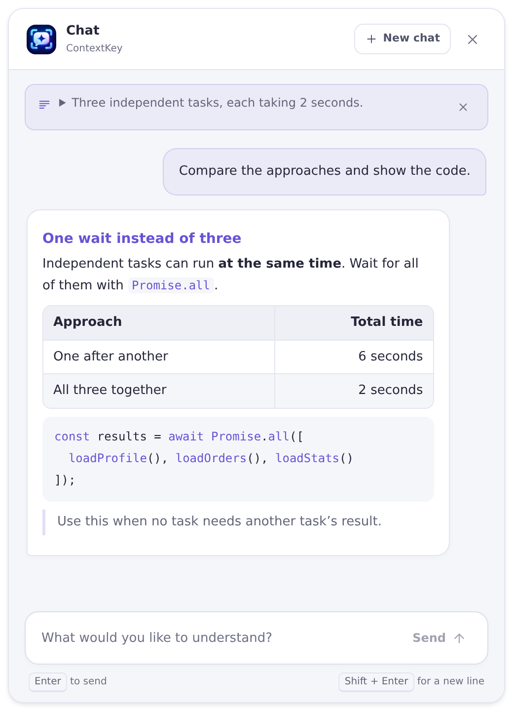
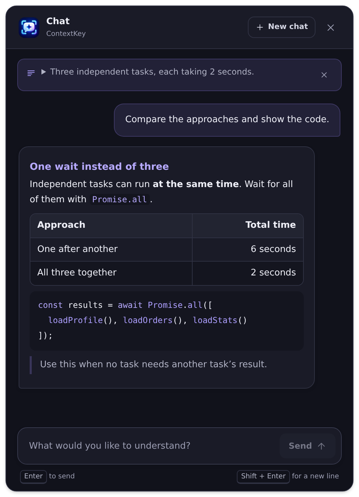
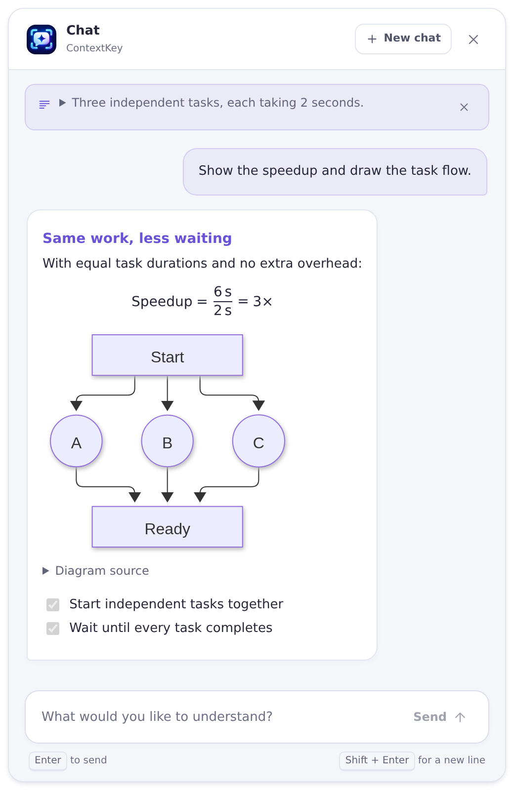
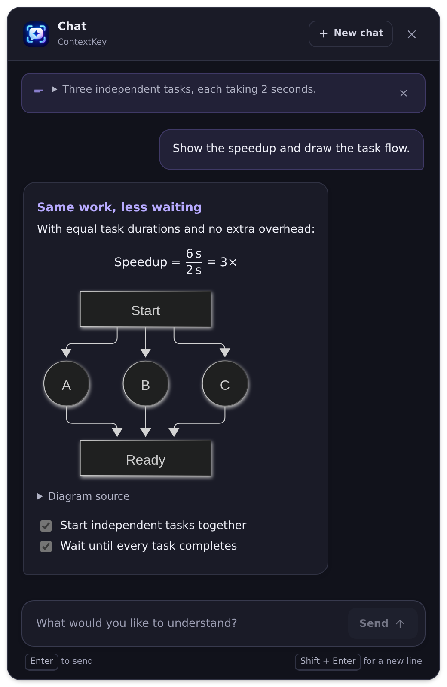
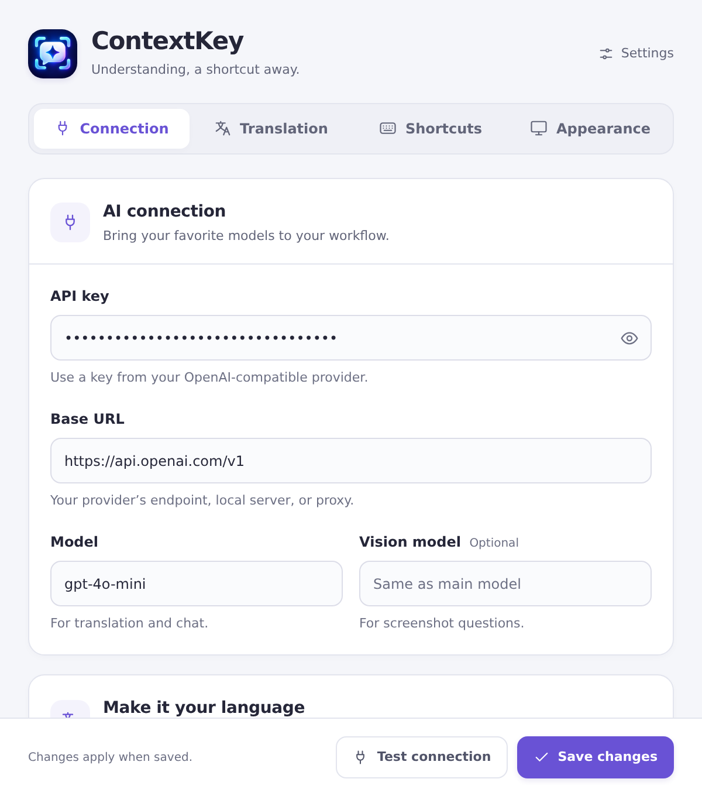
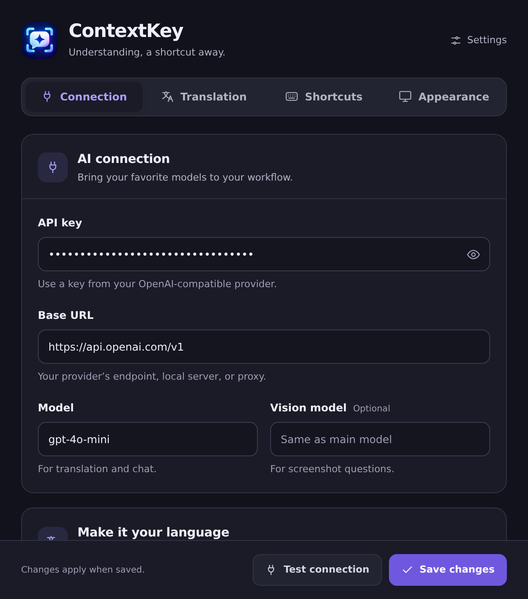
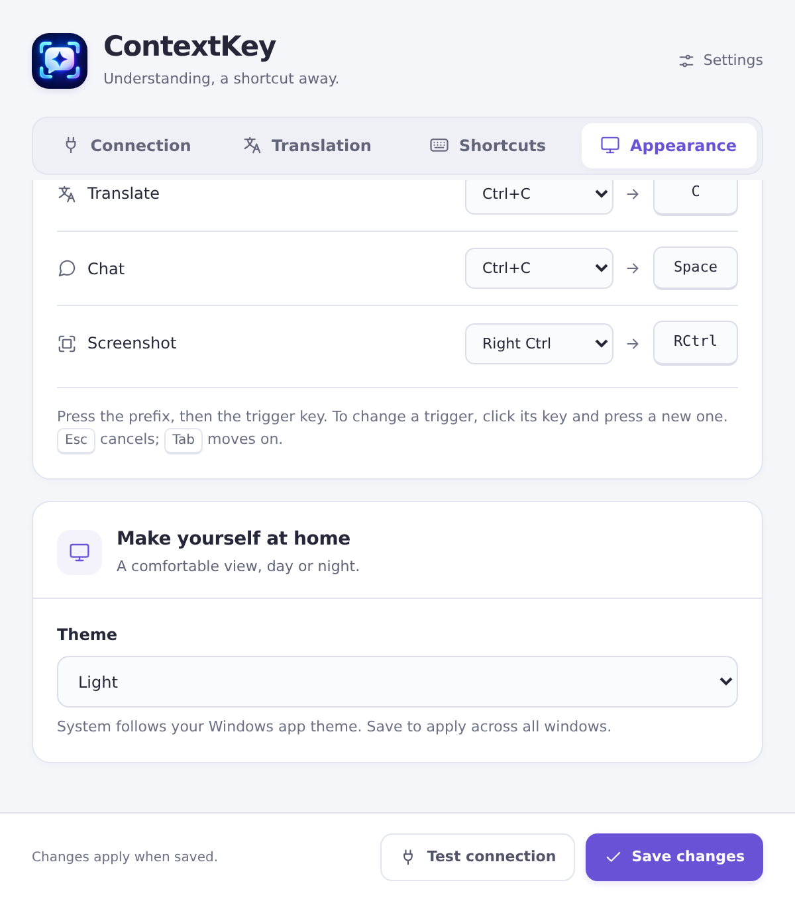
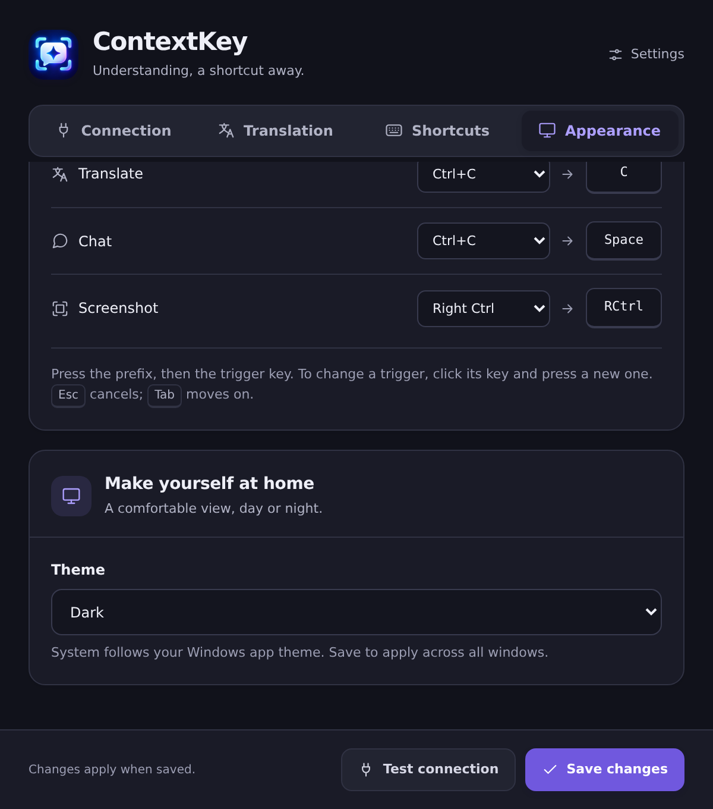

# UI previews

These screenshots show ContextKey's current frontend in light and dark themes, including formatted responses. They are captured from the actual HTML, CSS, and JavaScript in Chromium at 2× resolution, using sample conversations and simulated desktop commands. They illustrate the UI; native Windows behavior is covered by the [release checks](../../openspec/QA-CHECKLIST.md).

## Chat with tables and code

The selected text supplies context for a question about three independent tasks. The reply compares sequential and parallel execution in a table and shows highlighted JavaScript. The composer remains available below the answer.

| Light theme | Dark theme |
| :---: | :---: |
|  |  |

## Formulas and diagrams

A related answer shows the speedup formula, a Mermaid task-flow diagram, and a checklist. **Diagram source** opens the original text; wide diagrams can be scrolled without widening the chat window.

| Light theme | Dark theme |
| :---: | :---: |
|  |  |

## Translation with formatting

The English source becomes a Vietnamese translation with its heading and table preserved. **Copy** is available after the response completes.

| Light theme | Dark theme |
| :---: | :---: |
|  |  |

## Connection settings

Provider and model fields use sample values. The displayed key is a placeholder; the capture process does not contact a provider or load saved settings.

| Light theme | Dark theme |
| :---: | :---: |
|  |  |

## Appearance

Choose **System**, **Light**, or **Dark** in **Settings → Appearance → Theme**, then select **Save changes**.

| Light theme | Dark theme |
| :---: | :---: |
|  |  |

## Refresh the screenshots

From the repository root:

```sh
npm ci
npx playwright install chromium
npm run docs:screenshots
```

The [capture script](../../scripts/capture-docs.mjs) opens the local frontend, sends sample responses through the normal stream listeners, and waits for fonts, images, and diagrams before capturing all ten PNGs. It blocks HTTP requests and does not require an API key or a running desktop app. Set `PLAYWRIGHT_CHROMIUM_EXECUTABLE_PATH` to use an existing Chromium installation.

Chat and translation images retain transparent corners and the app's own shadow. Review both themes after changing the sample content or UI; confirm that the featured content and primary controls are visible. Commit the screenshots together with any updated captions.

[Back to ContextKey](../../Readme.md)
